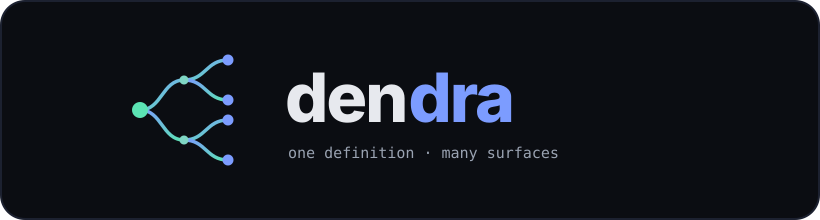
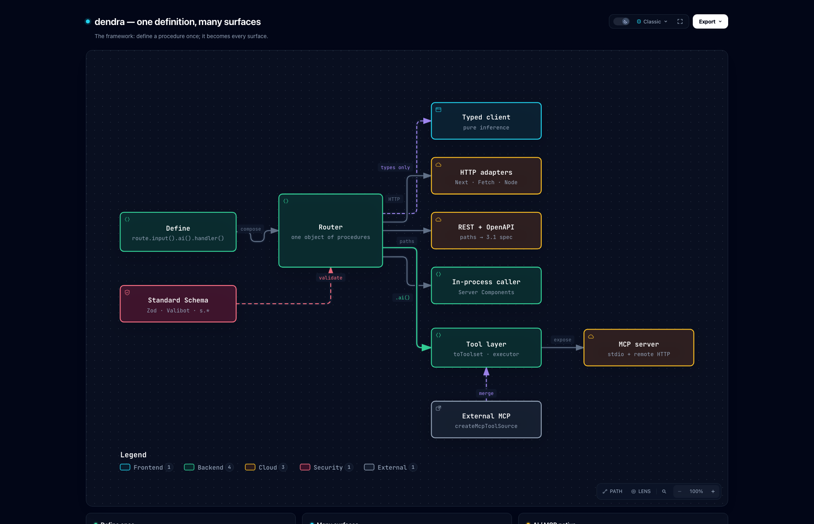
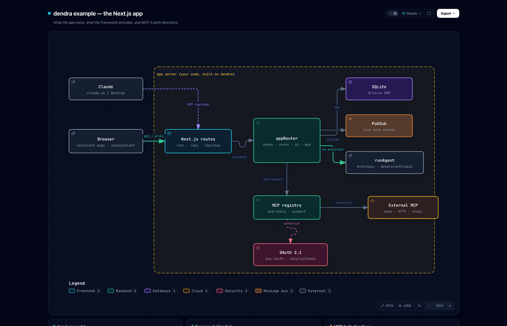

<div align="center">



<br>

**The typed API framework where every procedure is also an LLM tool and an MCP server — with zero extra work.**

[](https://www.npmjs.com/package/dendra)
[](https://github.com/zeestack/dendra/actions/workflows/ci.yml)
[](LICENSE)
[](package.json)
[](#)
[](#)

[Quickstart](#quickstart) · [AI / MCP](#the-ai--mcp-story) · [Architecture](#architecture) · [Example app](#examples) · [Compare](#how-it-compares)

</div>

---

Define a procedure once. Get a typed client, a REST endpoint, an OpenAPI schema,
streaming, real-time subscriptions — **and** an AI tool your agents can call and
an MCP server Claude can connect to. No decorators, no codegen, zero runtime deps.

```ts
export const appRouter = {
  notes: {
    create: route
      .post("/notes")
      .input(s.object({ title: s.string(), body: s.string() }))
      .ai({ description: "Create a note" })        // ← also an LLM/MCP tool
      .handler(({ input, ctx }) => ctx.db.create(input)),
  },
} satisfies RouterRecord;
```

That one definition is now callable as a **typed client method**, a **REST route**
(`POST /notes`), an **OpenAPI** operation, and — because of `.ai()` — a validated
**tool for Claude** over MCP. Same validation, same auth context, every surface.

## Why another API framework?

The typed-RPC space is crowded (tRPC, ts-rest, Hono, oRPC) and they're all good at
HTTP. dendra's wedge is the part they bolt on or skip entirely: **AI- and
MCP-native by construction.** A procedure and an LLM tool are the same shape —
a name, an input schema, a validated handler — so dendra treats them as one
thing. Mark a procedure `.ai()` and it's instantly:

- an **MCP tool** (stdio for Claude Desktop, or remote HTTP for claude.ai), and
- a tool definition for the **Anthropic / OpenAI** APIs, executed with the same
  validation that guards your HTTP endpoints — so hallucinated arguments are
  rejected and the model inherits the *user's* permissions, not god mode.

Everything else — zero deps, no decorators, no codegen, runtime-agnostic — is
table stakes it also happens to get right.

## One definition → many surfaces

<div align="center">

<br>
<sub><a href="https://htmlpreview.github.io/?https://github.com/zeestack/dendra/blob/main/docs/architecture/framework.html">▶ open the interactive diagram</a></sub>
</div>

The router is used **twice from one definition**: as a *type* that flows to the
client (erased at build — zero runtime), and as a *value* the adapters dispatch
against.

## Quickstart

```bash
npm i dendra
```

The core is zero-dependency. The optional helpers pull their own peers only if you
use them: `npm i @anthropic-ai/sdk` for `dendra/anthropic`, `react` for `dendra/react`.

**Define** once:

```ts
import { initDendra, s, type RouterRecord } from "dendra";

interface Ctx { userId: string | null }
const { route } = initDendra<Ctx>();

export const appRouter = {
  add: route
    .input(s.object({ a: s.number(), b: s.number() }))
    .ai({ description: "Add two numbers" })
    .handler(({ input }) => input.a + input.b),
  chat: route
    .input(s.object({ prompt: s.string() }))
    .stream(async function* ({ input }) {          // streaming = async generator
      for (const token of llm(input.prompt)) yield token;
    }),
} satisfies RouterRecord;

export type AppRouter = typeof appRouter;
```

**Serve** (Next.js App Router — `app/rpc/[...path]/route.ts`):

```ts
import { toNextHandler } from "dendra";
import { appRouter } from "@/server/router";

export const { GET, POST } = toNextHandler(appRouter, {
  createContext: (req) => ({ userId: getSession(req) }),
});
```

Other runtimes use the same router: `toFetchHandler` (Hono/Bun/Deno/Workers),
`toNodeHandler` (`node:http`).

**Call** — the client type comes straight from `typeof appRouter`, no generated files:

```ts
import { createClient } from "dendra";
import type { AppRouter } from "@/server/router";

const api = createClient<AppRouter>("");
const sum = await api.add({ a: 40, b: 2 });            // number, inferred
for await (const t of api.chat({ prompt: "hi" })) ...  // streaming, inferred
```

In a Server Component, skip HTTP entirely with `createCaller(appRouter, ctx)`.

## The AI / MCP story

```ts
import { toToolset, createToolExecutor, mcpToolDefinitions } from "dendra";

// LLM tool definitions (Anthropic/OpenAI shapes) from your .ai() procedures:
const tools = toToolset(appRouter, { format: "anthropic" });

// Execute a tool the model chose — validated, scoped to the user's ctx:
const execute = createToolExecutor(appRouter, ctx);
await execute("add", modelProvidedArgs);   // bad args rejected like any input

// MCP: the same procedures become tools Claude can call.
const defs = mcpToolDefinitions(appRouter);
```

Streaming procedures can be tools too — when an LLM/MCP calls a `.stream()` tool,
its chunks are **collected** into the tool result (string chunks are joined; other
chunks become an array), so you can expose streaming work without a special path.

The [Next.js example](examples/nextjs-app/) ships a working MCP server both ways:
a **stdio** server for Claude Desktop and a **remote HTTP** endpoint for claude.ai
(with optional OAuth 2.1) — so Claude can list, create, and delete your app's data
through the exact procedures you already wrote.

### Consuming external MCP servers (inbound tools)

The reverse direction too: pull tools **from** another MCP server (GitHub's,
Linear's, a filesystem server, your own) and merge them into the same toolset
your model already uses. dendra stays zero-dependency — it needs only the
two-method `McpClientLike` shape, which the official SDK's `Client` satisfies, so
*your app* owns the transport (stdio / HTTP) and dendra owns the tool plumbing.

```ts
import { toToolSource, mergeToolsets, createMcpToolSource } from "dendra";

const local = toToolSource(appRouter, ctx, { format: "anthropic" });
const external = await createMcpToolSource(mcpClient, {
  format: "anthropic",
  prefix: "gh.",            // optional: namespace to avoid name clashes
});

// One flat toolset; each call routes back to the source that owns the name.
const { tools, execute } = mergeToolsets(local, external);
```

### Optional helpers: the agentic loop + a React hook

Core stays zero-dependency, but two **optional subpath exports** remove the
boilerplate of a tool-using chat. They exchange one shared `AgentPart` type, so
they snap together — the loop emits parts, the hook renders them:

```ts
// server — dendra/anthropic (peer dep: @anthropic-ai/sdk)
import { runAgent } from "dendra/anthropic";
const { tools, execute } = mergeToolsets(toToolSource(appRouter, ctx), external);
yield* runAgent({ client, model, tools, execute, prompt, system });
```

```tsx
// client — dendra/react (peer dep: react)
import { useAssistant } from "dendra/react";
const { items, input, setInput, busy, send } = useAssistant({
  stream: (prompt) => api.ai.assistant({ prompt }),
  onPart: (p) => { /* act on a tool as it arrives */ },
  onDone: (parts, { spoken }) => { /* speak the reply */ },
});
```

Neither is required — bring your own loop/UI and just use `mergeToolsets`.

## Middleware & auth (`.use()`)

Run logic before a handler — authentication, logging, rate-limiting — and enrich
the context. One `.use()` runs across **every** transport (RPC, REST, the
in-process caller, WebSocket, and AI/MCP tool execution).

```ts
const authed = route.use(({ ctx }) => {
  if (!ctx.token) throw new DendraError("UNAUTHORIZED", "Sign in required");
  return { userId: lookup(ctx.token) };   // merged into ctx, typed downstream
});

export const appRouter = {
  me:     authed.handler(({ ctx }) => ctx.userId),          // ctx.userId is typed
  delete: authed.input(s.object({ id: s.string() }))
                .ai({ description: "Delete an item" })        // tool is auth-guarded too
                .handler(({ ctx, input }) => db.remove(ctx.userId, input.id)),
} satisfies RouterRecord;
```

Middlewares **stack** and **throw a `DendraError` to reject**. Because an AI/MCP
tool runs through the same dispatch path, a procedure behind `.use(auth)` is
authorization-guarded for the model too — it inherits the user's permissions, it
can't bypass them.

## Class-based controllers (NestJS-style, no decorators)

Prefer classes for grouping and dependency injection? A controller is just a
class whose **fields are procedures** — put an *instance* in the router. NestJS
structure and constructor DI without decorators, `reflect-metadata`, or
`experimentalDecorators`.

```ts
export class UsersController {
  #db: Db;                                        // #private: not part of the
  constructor(db: Db) { this.#db = db; }          // public (procedures-only) type

  list = route.get("/users").handler(() => this.#db.users.all());
  create = route
    .post("/users")
    .input(s.object({ name: s.string() }))
    .ai({ description: "Create a user" })         // still an LLM/MCP tool
    .handler(({ input }) => this.#db.users.insert(input));
}

export const appRouter = {
  users: new UsersController(db),                 // an instance = a sub-router
};
```

| NestJS | dendra |
|---|---|
| `@Controller()` class | plain class with procedure fields |
| `@Get()` / `@Post()` decorators | `.get()` / `.post()` on the builder |
| `@Injectable()` + DI container | constructor injection (`new Ctrl(deps)`) |
| `@Module()` | compose the router object |
| decorators / `reflect-metadata` | none |

## How it compares

| | tRPC | ts-rest | Hono | **dendra** |
|---|---|---|---|---|
| Typed client, no codegen | ✅ | — | ✅ | ✅ |
| REST URLs + OpenAPI | plugin | ✅ | plugin | ✅ |
| Streaming | links | — | ✅ | ✅ |
| Real-time / WebSocket | subs | — | ✅ | ✅ |
| **LLM tools from procedures** | — | — | — | ✅ |
| **MCP server (stdio + HTTP)** | — | — | — | ✅ |
| **Consume external MCP servers** | — | — | — | ✅ |
| Decorators / codegen | none | none | none | **none** |
| Runtime deps | few | few | 0 | **0** |

Not trying to out-tRPC tRPC on HTTP — winning on the AI/MCP seam.

## Also in the box

- **REST + OpenAPI** — give a procedure `.get("/users/:id")` and `.output(schema)`
  (type-checks the handler's return *and* documents the response); `toRestHandler`
  serves it, `toOpenApiDocument` emits a 3.1 spec.
- **Real-time** — a subscription is a streaming procedure fed by a `PubSub`
  interface: `createInMemoryPubSub()` for dev, `createRedisPubSub(client)` for
  multi-instance fan-out.
- **External MCP tools** — `createMcpToolSource(client)` + `mergeToolsets(...)`
  blend remote tools into your agent loop.
- **WebSocket** — `attachWs` / `connectWs` multiplex unary calls + subscriptions
  over one socket, same router.
- **Request batching** — `createClient(url, { batch: true })` collects unary calls
  made in the same tick into one HTTP round-trip (streaming stays direct).
- **Standard Schema** — Zod, Valibot, ArkType, or the built-in `s.*` validators.

## Architecture

[`ARCHITECTURE.md`](ARCHITECTURE.md) explains the split between the **framework**
(`dendra`, in `src/`) and the **app** (the Next.js example) — and why auth,
navigation, voice, and MCP connection/OAuth management are app concerns while only
the typed-procedure and tool-shaping primitives live in the framework.

## Examples

<div align="center">

<br>
<sub><a href="https://htmlpreview.github.io/?https://github.com/zeestack/dendra/blob/main/docs/architecture/example.html">▶ open the interactive diagram</a></sub>
</div>

- [`examples/demo.ts`](examples/demo.ts) — caller, unary, validation, streaming, AI tools, pub/sub.
- [`examples/rest-ws-demo.ts`](examples/rest-ws-demo.ts) — REST, OpenAPI, WebSocket transport.
- [`examples/nextjs-app/`](examples/nextjs-app/) — full Next.js app: RPC + REST,
  Server Components, generative-UI chat with voice, real LLM, subdomain
  multi-tenancy, resilient real-time notes, a NestJS-style class controller, MCP
  both ways (serve to Claude **and** connect out to external MCP servers with
  OAuth 2.1).

## Develop

```bash
npm install
npm run build      # tsup → ESM + CJS + .d.ts in dist/ (core + /anthropic + /react)
npm test           # vitest: runtime + type-level inference tests
npm run demo       # boots a server + typed client, exercises everything
npm run demo:restws
```

## Status

**Pre-1.0 (v0.1.0) — experimental, but broad.** Implemented and tested
(32 tests, runtime + type-level): builder/router/dispatch, Standard Schema
validation, Next/Fetch/Node adapters, REST + OpenAPI, inferred client (unary +
streaming), NDJSON streaming with cancellation, WebSocket transport, middleware
(`.use()`), typed `.output()`, request batching, in-memory **and** Redis pub/sub,
class controllers, AI tools, MCP (stdio + remote HTTP, consume external MCP
servers), and optional `dendra/anthropic` + `dendra/react` helpers.

Published on npm as [`dendra`](https://www.npmjs.com/package/dendra). APIs may
change before 1.0.

## License

MIT
